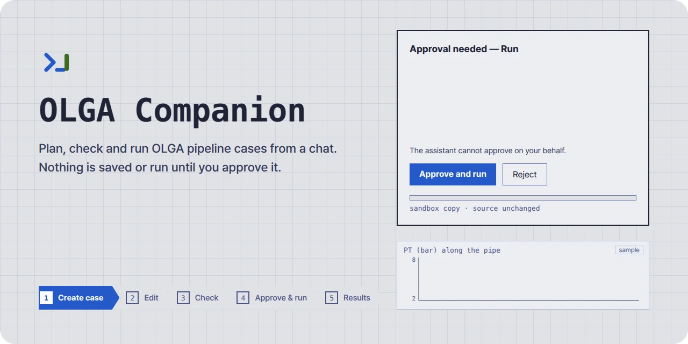
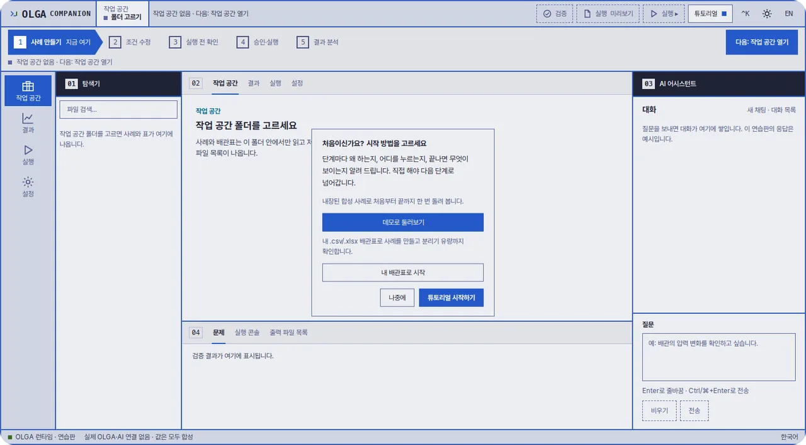
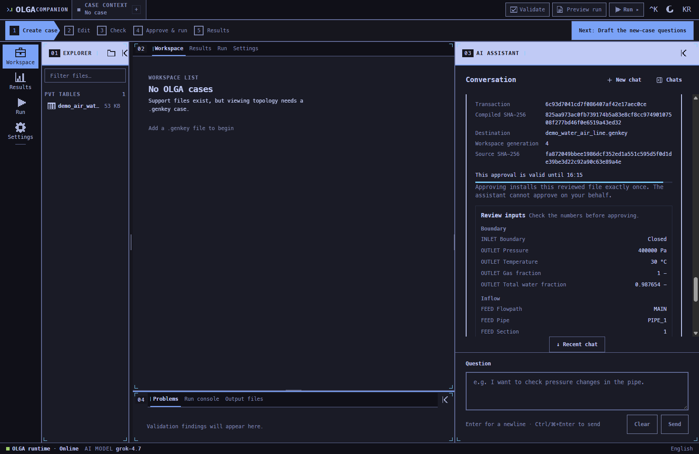
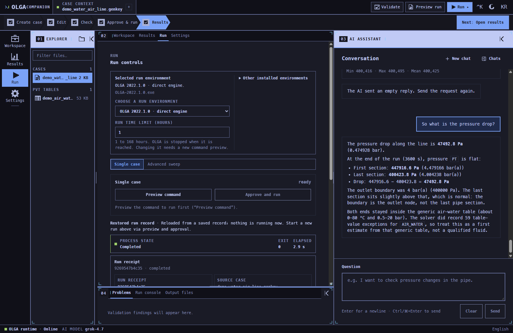
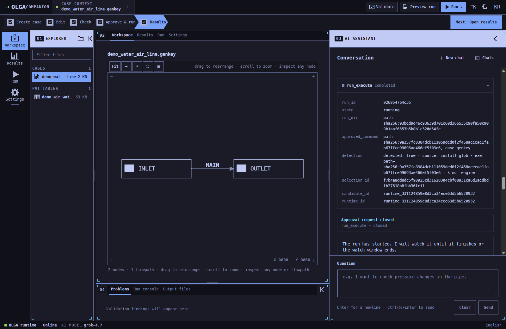
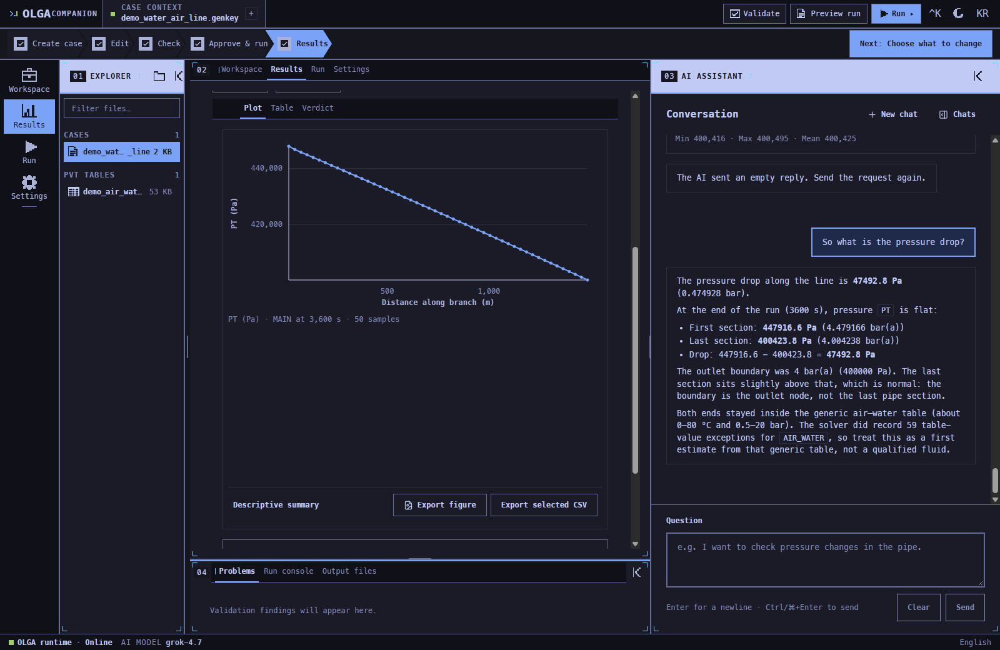
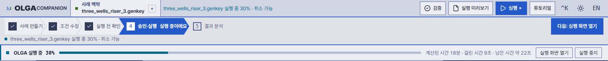
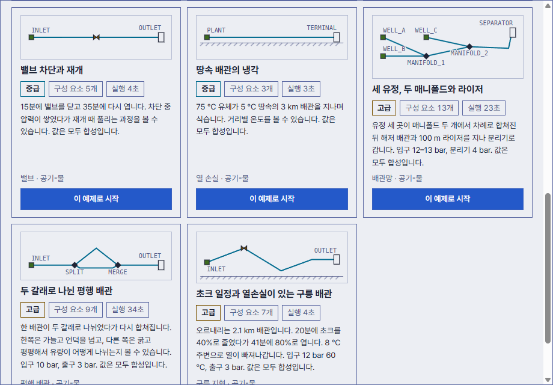
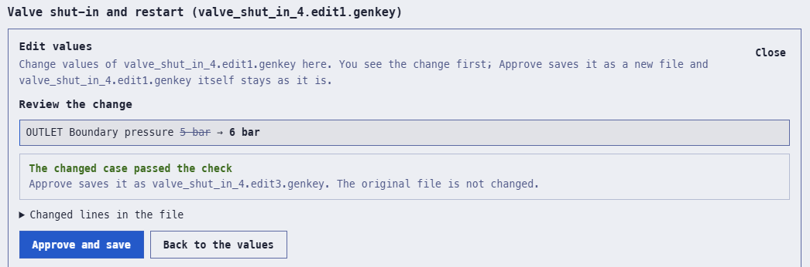

<div align="center">

<a id="olga-companion"></a>

<picture>
  <source media="(prefers-reduced-motion: reduce) and (prefers-color-scheme: dark)" srcset="./docs/assets/readme/cover-dark.png" />
  <source media="(prefers-reduced-motion: reduce)" srcset="./docs/assets/readme/cover-light.png" />
  <source media="(prefers-color-scheme: dark)" srcset="./docs/assets/readme/cover-dark.webp" />
  
</picture>

<h1>OLGA Companion</h1>

<p><b>다상 배관을 평소 말로 설명하고, 단계마다 승인하고, OLGA를 돌리고, 답을 읽습니다.</b></p>

<p><a href="./README.md">English</a> · <b>한국어</b></p>

<p>
  <a href="https://github.com/wjgoarxiv/olga-companion/releases/latest"></a>
  
  
  <a href="./LICENSE"></a>
  
</p>

<p>
  <a href="#quick-start">빠른 시작</a> ·
  <a href="#try-the-tutorial">튜토리얼</a> ·
  <a href="./docs/intro.html">소개 슬라이드</a> ·
  <a href="#five-steps">다섯 단계</a> ·
  <a href="#features">기능</a> ·
  <a href="#safety-model">안전 장치</a> ·
  <a href="#faq">자주 묻는 질문</a> ·
  <a href="#documentation">문서</a> ·
  <a href="#contributing">참여하기</a>
</p>

</div>

OLGA Companion은 OLGA를 쓰는 엔지니어와 OLGA를 배우는 사람을 위한 Windows 데스크톱 앱입니다. AI 어시스턴트와 대화하면 어시스턴트가 내 PC에서 실제 OLGA 사례를 만들고, 검증하고, 실행합니다. **파일 쓰기, 사례 저장, 시뮬레이션 시작처럼 결과가 남는 일은 모두 승인 카드에서 멈추고 사용자의 클릭을 기다립니다. 어시스턴트가 대신 승인할 수는 없습니다.**

<a id="quick-start"></a>

## 빠른 시작

1. [최신 릴리스](https://github.com/wjgoarxiv/olga-companion/releases/latest)에서 Windows 설치 파일(`_x64-setup.exe` 또는 `.msi`)을 내려받습니다.
2. 설치 파일을 실행합니다. WebView2가 없으면 설치 중에 함께 받습니다.
3. **OLGA Companion**을 열고 **설정**에서 AI 공급자를 연결한 뒤, 사례를 둘 폴더를 고릅니다.
4. 제목 표시줄의 **튜토리얼**을 누르면 첫 사례를 일곱 단계로 안내합니다.

> [!IMPORTANT]
> 설치 파일에는 아직 코드 서명이 없어서 Windows SmartScreen이 경고할 수 있습니다. 실행하기 전에 릴리스에 첨부된 `SHA256SUMS.txt`와 SHA-256 값을 비교하세요.

<a id="try-the-tutorial"></a>

## 튜토리얼 체험하기

<a href="https://wjgoarxiv.github.io/olga-companion/tutorial/">
  <picture>
    <source media="(prefers-reduced-motion: reduce) and (prefers-color-scheme: dark)" srcset="./docs/assets/readme/tutorial-preview-dark.png" />
    <source media="(prefers-reduced-motion: reduce)" srcset="./docs/assets/readme/tutorial-preview-light.png" />
    <source media="(prefers-color-scheme: dark)" srcset="./docs/assets/readme/tutorial-preview-dark.webp" />
    
  </picture>
</a>

**[브라우저에서 튜토리얼 열기](https://wjgoarxiv.github.io/olga-companion/tutorial/)**. 앱 화면을 그대로 옮긴 연습용 페이지라 직접 눌러 보며 따라갈 수 있습니다. 화면 배치, 색, 단계 막대, 승인 카드, 움직임이 앱과 같고, 앱 안의 **튜토리얼** 버튼과 같은 일곱 단계를 따라갑니다. OLGA나 AI 공급자에는 연결하지 않으며, 나오는 값은 모두 연습용으로 만든 값입니다.

- **두 가지 길.** “데모로 둘러보기”는 연습용 공기–물 수평관을 설치해 검증부터 결과까지 이어 갑니다. “내 배관표로 시작”은 배관표 마법사(표 고르기 → 내용 확인 → 끝점 값 → 요청 넣기)로 요청을 보내고, 저장 카드를 승인한 뒤, 표에 적힌 이름 그대로 검증·실행하고 분리기 유량을 읽습니다.
- **오프라인 사본.** 같은 페이지가 [`docs/tutorial/index.html`](./docs/tutorial/index.html)에 있습니다. 저장소를 내려받아 이 파일을 브라우저로 열면 서버나 네트워크 없이 동작합니다.
- **밝은 화면, 어두운 화면, 움직임 끄기.** 페이지 위쪽에 테마 전환과 움직임 설정(끔 / 은은함 / 전체)이 있습니다. 직접 고르기 전까지는 시스템 설정을 따릅니다.
- 튜토리얼 문구는 앱의 한국어 화면에서 그대로 가져왔습니다.

<a id="five-steps"></a>

## 다섯 단계로 끝내는 첫 시뮬레이션

앱 위쪽의 단계 막대가 지금 어디에 있고 다음에 무엇을 할지 늘 보여 줍니다.

| 단계 | 할 일 | 끝나면 보이는 것 |
|---|---|---|
| **1. 사례 만들기** | 대화로 배관을 설명하거나, 데모를 설치하거나, 배관표로 사례를 만듭니다. | 사례가 작업 공간에 저장되고 열립니다. |
| **2. 조건 수정** | 작업 공간 화면에서 **값 고치기**를 눌러 숫자를 직접 바꾸거나, 채팅으로 평소 쓰는 단위로 요청합니다. 어느 쪽이든 바뀐 부분을 확인하고 저장을 승인합니다. | 검토를 거친 새 사본이 생깁니다. 원래 `.genkey`는 그 자리에서 바뀌지 않습니다. |
| **3. 실행 전 확인** | 제목 표시줄의 **검증**을 누릅니다. 실행 전에 사례를 점검합니다. | 문제 패널에 이 사례의 오류와 경고가 나옵니다. |
| **4. 승인·실행** | 실행 화면에서 실제로 실행될 명령을 미리 보고, **승인하고 실행**을 직접 누릅니다. | 진행 상황, 제한 시간, 중지 버튼이 보입니다. |
| **5. 결과 분석** | **결과**를 엽니다. | 실행에서 나온 `.tpl`, `.ppl` 파일의 시간 추이와 배관 길이 방향 분포를 그래프와 CSV로 볼 수 있습니다. |

실제 대화를 줄여서 옮겼습니다. 숫자는 앱과 OLGA가 낸 값 그대로입니다.

```text
나        OLGA는 처음입니다. 물 4 kg/s와 공기 0.05 kg/s가 수평 강관을 흐릅니다.
          길이 1.5 km, 내경 120 mm, 출구 4 bar(a), 30 °C입니다.
          압력은 얼마나 떨어지나요?

어시스턴트  닫힌 입구에 질량 유량 공급 하나(4.05 kg/s, 물 분율 4/4.05 = 0.987654),
          강관 거칠기 4.5e-5 m, 50개 구간, 3600 s, 범용 공기-물 표 사본을
          제안합니다. 그리고 사용자의 승인을 기다립니다.

나        네, 제안대로 해 주세요.

          [승인: 표 쓰기]  [승인: 사례 저장]  [승인: OLGA 실행]

어시스턴트  첫 구간 447 916.6 Pa, 마지막 구간 400 423.8 Pa이므로 압력 강하는
          47 492.8 Pa(0.475 bar)입니다. 범용 표를 썼으니 첫 추정치로 보세요.
```

<a id="features"></a>

## 기능

<table>
<tr>
<td width="50%" valign="top">

**대화로 사례 만들기**<br />
배관, 유량, 출구 조건을 평소 쓰는 단위로 말하면 됩니다. 어시스턴트가 단위를 바꾸고, 빠진 값(거칠기, 구간 수, 종료 시간)은 이유와 함께 제안하며, 채우기 전에 먼저 묻습니다.

</td>
<td width="50%" valign="top">

**승인 카드**<br />
쓰기, 저장, 실행마다 압력, 유량, 분율, 좌표 같은 입력값을 그대로 보여 줍니다. **승인**을 누르기 전에는 아무 일도 일어나지 않습니다. 승인은 한 번만 쓸 수 있고 10분이 지나면 만료됩니다.

</td>
</tr>
<tr>
<td></td>
<td></td>
</tr>
<tr>
<td valign="top">

**실제 OLGA 실행**<br />
내 PC의 OLGA를 앱이 관리하는 별도 작업 폴더에서 실행합니다. 진행 상황, 제한 시간, 취소를 지원합니다. 단일 실행과 파라미터 스윕 모두 사용자의 승인을 기다립니다.

</td>
<td valign="top">

**확인할 수 있는 결과**<br />
`.tpl`의 시간 추이, `.ppl`의 배관 길이 방향 분포, 그래프, 원본 파일이 표시된 CSV 내보내기를 제공합니다. 어시스턴트는 실행 파일에서 읽은 값을 근거로 답합니다.

</td>
</tr>
<tr>
<td></td>
<td></td>
</tr>
<tr>
<td valign="top">

**배관표와 사례 살펴보기**<br />
`.csv`나 `.xlsx` 배관표로 네 단계 마법사를 거쳐 네트워크를 만듭니다. 표에 없는 끝점 값만 묻고, 요청은 대화 입력창에 넣어 두기만 하고 보내지는 않습니다. OLGA를 열지 않고도 `.genkey`의 네트워크, 형상, 유체 표를 살펴볼 수 있습니다.

</td>
<td valign="top">

**유체 표와 내가 고른 AI**<br />
사례 옆의 `.mfl`로 OLGA에 함께 설치된 Multiflash 엔진을 써서 빠진 `.tab`을 만들거나, 이미 가진 물성값으로 `.tab`을 쓰거나, 함께 들어 있는 범용 공기–물 표로 시작합니다. OpenAI(Codex), GitHub Copilot, Antigravity(Gemini), xAI(Grok)를 연결하거나, OpenAI 호환 주소에 API 키를 추가할 수 있습니다. HD AIC는 미리 준비된 항목이 있어 주소를 채우고 내 키로 쓸 수 있는 모델 목록을 불러옵니다.

</td>
</tr>
<tr>
<td valign="top">

**어느 화면에서나 보이는 실행 진행 표시줄**<br />
OLGA가 도는 동안 단계 막대 아래 표시줄에 진행률, 계산된 시간, 걸린 시간, 남은 시간 추정이 나오고, 실행 화면 열기와 중지 버튼이 함께 있습니다. 다른 화면으로 옮겨도 그대로 남아 있고, 실행이 끝나면 **결과 열기**가 나옵니다.

</td>
<td valign="top">

**예제 모음**<br />
바로 돌려 볼 수 있는 공기-물 사례 11개입니다. 수평관 하나부터, 유정 세 곳이 매니폴드 두 개에서 합쳐져 라이저로 올라가는 사례까지 있습니다. 카드마다 사례의 배관 구성을 그림으로 보여 주고, 정해진 기준에 따른 난이도와 구성 요소 수, 기준 PC에서 실제로 돌려 잰 실행 시간을 함께 보여 줍니다.

</td>
</tr>
<tr>
<td></td>
<td></td>
</tr>
<tr>
<td colspan="2" valign="top">

**값을 직접 고치기**<br />
열린 사례에서 **값 고치기**를 누르면 어시스턴트 없이 종료 시간, 경계 압력과 온도, 질량 유량, 밸브 열림, 관 거칠기를 bar, °C, kg/s, %, mm 단위로 바꿀 수 있습니다. 어시스턴트가 고칠 때와 같은 검사를 거칩니다. 바꾼 사례를 컴파일하고 검증한 뒤 바뀌는 내용을 보여 주고, **승인하고 저장**을 눌러야 저장합니다. 결과는 원본 옆의 새 파일이고, 원본은 바뀌지 않습니다.

</td>
</tr>
<tr>
<td colspan="2"></td>
</tr>
</table>

사례, 대화, 실행 기록은 내 PC에 저장됩니다. 대화창에 입력한 내용은 연결한 AI 공급자에게 전송됩니다. 화면은 영어와 한국어를 지원하고, 밝은/어두운 테마, 움직임 설정, 글자 크기 설정이 있습니다.

<a id="safety-model"></a>

## 안전 장치

OLGA Companion은 시뮬레이션 파일과 모델 출력을 믿을 수 없는 입력으로 다룹니다.

| 경계 | 동작 |
|---|---|
| OLGA 실행 | 실제로 실행될 명령을 미리 보여 주고 승인을 받아야 합니다. |
| 사례 저장 | 승인이 필요합니다. 원본 `.genkey`는 그 자리에서 바뀌지 않습니다. |
| 파일 쓰기 | 고른 작업 공간이나 앱 전용 작업 폴더 안에서만 씁니다. |
| 승인 | 한 번만 쓸 수 있고 10분 동안 유효하며, 대화 모델에는 보이지 않습니다. 어시스턴트는 승인 버튼을 누를 수 없습니다. |
| 네트워크 | 사이드카는 루프백 주소에서만 받으며, `/api/*`는 실행할 때마다 새로 만드는 세션 토큰이 있어야 합니다. |
| 결과 파일 | 읽기 전후에 해시를 비교하고, 읽는 사이에 바뀐 파일은 거부합니다. |
| 업데이트 | 기본값으로 앱이 시작한 직후 새 버전을 한 번 확인해 상태 표시줄에 알립니다. **설정 → 업데이트**에서 끌 수 있습니다. 내려받기와 설치는 각각 따로 눌러야 하며, 모든 릴리스는 앱에 들어 있는 공개 키로 검증합니다. |

전체 규칙은 [Safety Gates](docs/SAFETY_GATES.md)에 있습니다.

## 필요한 것

| 항목 | 쓰이는 곳 | 비고 |
|---|---|---|
| Windows x64 | 전부 | OLGA가 Windows용 프로그램입니다 |
| OLGA | 실제 실행 | OLGA 2022.1에서 시험했습니다. 살펴보기와 결과 읽기는 OLGA 없이도 됩니다 |
| AI 공급자 | 대화 | OpenAI(Codex), GitHub Copilot, Antigravity(Gemini), xAI(Grok), 또는 API 키 |
| Multiflash | 선택 | 사례에 맞춘 유체 표. OLGA에 함께 들어 있는 Multiflash 엔진으로 앱이 `.mfl`에서 `.tab`을 만듭니다 |

<a id="faq"></a>

## 자주 묻는 질문과 문제 해결

<details>
<summary><b>Windows SmartScreen이 설치 파일을 막습니다.</b></summary>

지금은 서명하지 않은 설치 파일입니다. 릴리스 페이지의 `SHA256SUMS.txt`와 SHA-256 값을 비교한 뒤 **추가 정보 → 실행**을 고르세요.

</details>

<details>
<summary><b>이 PC에 OLGA가 없어도 앱을 쓸 수 있나요?</b></summary>

네. 사례를 만들고 검증하고, `.genkey`를 살펴보고, 이미 있는 `.tpl`/`.ppl` 결과를 읽을 수 있습니다. 시뮬레이션 실행에는 라이선스가 있는 OLGA가 PC에 설치되어 있어야 합니다. 앱이 OLGA를 찾지 못하면 앱 안의 튜토리얼은 검증 단계에서 끝납니다.

</details>

<details>
<summary><b>어시스턴트가 멈추거나 빈 답을 보냈습니다.</b></summary>

AI 모델에서 가끔 생기는 일입니다. 앱이 다시 시도하라는 안내를 띄우고, 다시 물으면 하던 일을 이어 갑니다. 저장과 실행은 승인을 기다리므로 그 사이에 저장되거나 실행된 것은 없습니다.

</details>

<details>
<summary><b>회사 네트워크에서 답이 자꾸 끊깁니다.</b></summary>

**설정 → 네트워크**에서 관리자가 허용한 로컬 프록시로 공급자 통신을 보낼 수 있습니다. [Network](docs/NETWORK.md)를 참고하세요.

</details>

<details>
<summary><b>승인 카드가 만료되었다고 나옵니다.</b></summary>

카드는 10분 동안 유효하고 한 번만 쓸 수 있습니다. 어시스턴트에게 그 단계를 다시 제안해 달라고 한 뒤 새 카드를 승인하세요.

</details>

<details>
<summary><b>앱은 파일을 어디에 쓰나요?</b></summary>

사례와 표는 사용자가 고른 작업 공간 폴더에 씁니다. 실행은 앱이 관리하는 별도 작업 폴더의 사본에서 하므로 원본 사례는 그대로 남습니다.

</details>

<details>
<summary><b>소스에서 빌드하기와 Windows 패키지</b></summary>

Node.js 22.12 이상, Python 3.11 이상, `uv`가 필요합니다.

```bash
git clone https://github.com/wjgoarxiv/olga-companion.git
cd olga-companion
npm ci
uv sync --extra results --group dev
npm run verify         # 프론트엔드 테스트, 타입 검사, 빌드, 백엔드 테스트
npm run dev:app        # 프론트엔드 :5273, 사이드카 :8865
```

**Windows 패키지.** 설치 파일을 만들려면 Rust MSVC 도구 체인과 PyInstaller도 있어야 합니다. 설치 파일에는 데스크톱 셸, 묶어 놓은 Python 사이드카, OLGA 도구 스크립트가 들어 있고 OLGA는 들어 있지 않습니다. [Packaging Runbook](docs/PACKAGING.md)을 참고하세요.

</details>

<details>
<summary><b>알려진 한계</b></summary>

- **Windows 전용입니다.** OLGA 자체가 Windows용 프로그램입니다.
- **실제 실행에는 라이선스가 있는 OLGA 설치가 필요합니다.**
- **판정이 아니라 설명입니다.** 요약은 실행 결과가 보여 주는 내용을 설명할 뿐이고, 설계가 기준을 통과하는지는 엔지니어가 판단합니다.
- **함께 들어 있는 공기-물 표는 범용 표입니다**(CPA, 0–80 °C, 0.5–20 bar). 학습과 빠른 확인용이라 OLGA가 표 값 경고를 냅니다. 실제 업무에는 사례에 맞춘 표를 쓰세요.
- **`.mfl`로 표를 만들려면 OLGA에 함께 들어 있는 Multiflash 엔진이 있어야 합니다** (OLGA 2022.1.0, Multiflash 7.3에서 확인). OLGA 표만 만들며, 하이드레이트·왁스 파일은 지금처럼 Multiflash에서 만듭니다.
- **독립 유체 표 생성기는 로컬 빌드에서만 쓸 수 있습니다.** 릴리스 빌드에는 빠져 있고, 이 생성기가 만든 표는 Multiflash 결과와 똑같지 않습니다.
- **AI 모델이 멈추거나 빈 답을 보낼 수 있습니다.** 앱이 다시 시도하라는 안내를 띄우고, 다시 물으면 하던 일을 이어 갑니다.
- **코드 서명 인증서를 갖추기 전까지 설치 파일은 서명되지 않습니다.**

</details>

## 동작 방식

```
  [ React UI ]  Tauri 2 WebView, English / 한국어
       |  인증된 로컬 HTTP + SSE (127.0.0.1)
       v
  [ Python 사이드카 ]  FastAPI, PyInstaller로 묶음
       +--> 대화 에이전트     도구, 승인 카드, 내가 연결한 AI 공급자
       +--> 사례 처리        .genkey 사양 / 검증 / 컴파일 / 저장
       +--> 실행 관리        별도 작업 폴더, 진행 상황, 취소, 제한 시간
       +--> 결과 읽기        .tpl / .ppl, 해시 확인
       v
  [ OLGA ]  사용자의 라이선스 OLGA 설치본. 앱에 포함하지 않고 수정하지도 않음
```

<a id="documentation"></a>

## 문서

| 문서 | 내용 |
|---|---|
| [체험용 튜토리얼](https://wjgoarxiv.github.io/olga-companion/tutorial/) | 일곱 단계 연습 페이지, 데모 길과 배관표 길 |
| [Architecture](docs/ARCHITECTURE.md) | 구성 요소와 저장 경계 |
| [Safety Gates](docs/SAFETY_GATES.md) | 파일, 실행, 결과 규칙 전체 |
| [Pipe tables](docs/PIPE_TABLE.md) | 배관표 가져오기의 열, 끝점, 분기점, 한계 |
| [Make a .tab from your values](docs/TAB_IMPORT.md) | 가진 값으로 OLGA PVT 표 쓰기 |
| [Network](docs/NETWORK.md) | 회사 네트워크용 프록시 설정 |
| [Packaging Runbook](docs/PACKAGING.md) | Windows 설치 파일 빌드 |

세부 문서는 영어로 되어 있습니다.

<a id="contributing"></a>
## 참여하기

이슈와 풀 리퀘스트를 환영합니다. `master`에서 브랜치를 만들고, 변경은 작게 유지하고, 동작이 바뀌면 회귀 테스트를 추가하고, 무엇을 확인했는지 풀 리퀘스트에 적어 주세요.

- [참여 안내](./CONTRIBUTING.md): 개발 환경, 테스트, 커밋과 풀 리퀘스트 규칙
- [보안 정책](./SECURITY.md): 취약점은 비공개로 알려 주세요
- [행동 강령](./CODE_OF_CONDUCT.md): Contributor Covenant 2.1
- [라이선스](./LICENSE): Apache 2.0

안내 문서는 영어로 되어 있습니다.

## 라이선스

[Apache License 2.0](./LICENSE)([NOTICE](./NOTICE) 참고). 엔진 폴더 [`src/olga_companion/pvt_engine/`](src/olga_companion/pvt_engine/LICENSE)는 MIT 라이선스입니다. 튜토리얼 페이지에는 Pretendard(SIL OFL 1.1)와 Meslo LGS NF(Apache 2.0)가 들어 있으며, 라이선스 전문은 [`docs/tutorial/assets/fonts/`](docs/tutorial/assets/fonts/)에 있습니다.

OLGA는 SLB의 제품입니다. 이 앱은 독립적으로 만든 보조 앱이며 SLB와 제휴하거나 SLB의 보증·후원을 받지 않았습니다.

<div align="center">

만든 사람 **[Woojin Go](https://github.com/wjgoarxiv)** · <a href="#olga-companion">맨 위로 ↑</a>

</div>
