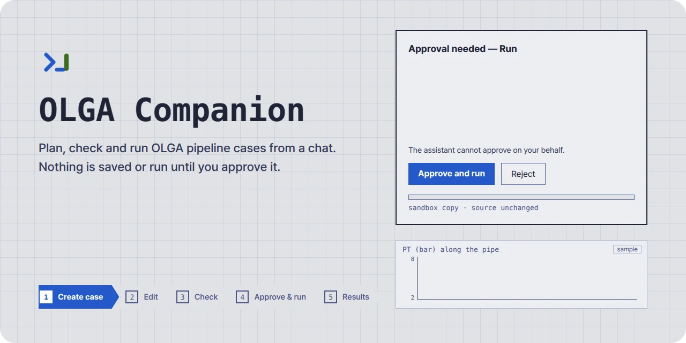
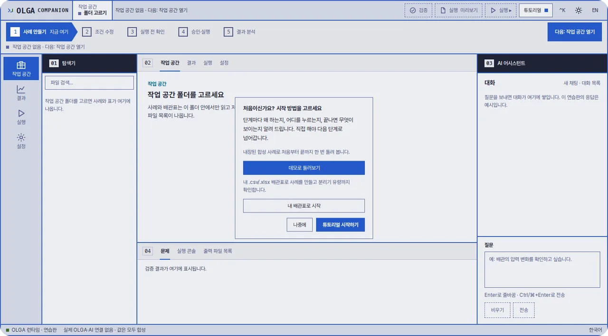
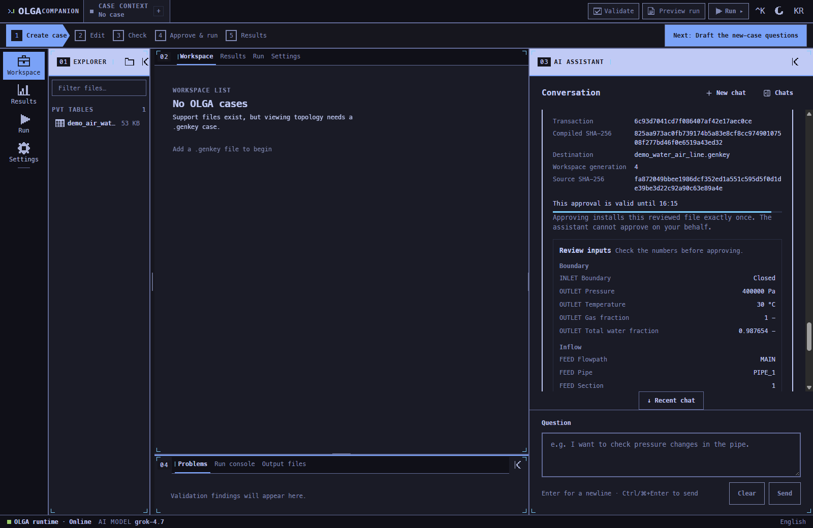
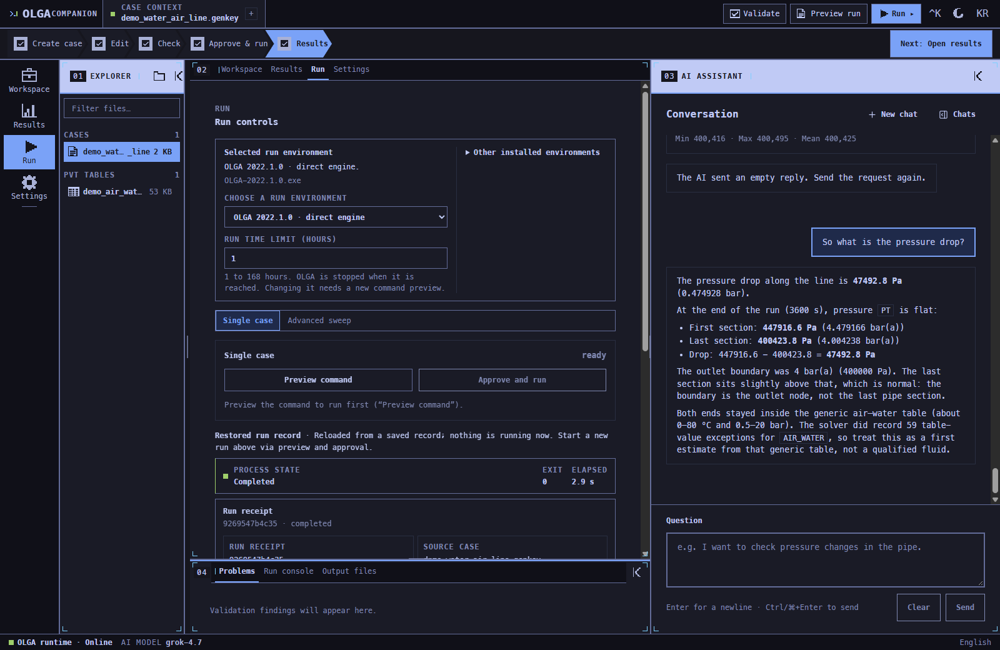
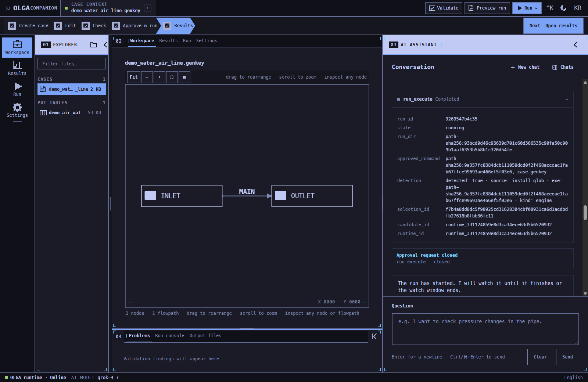
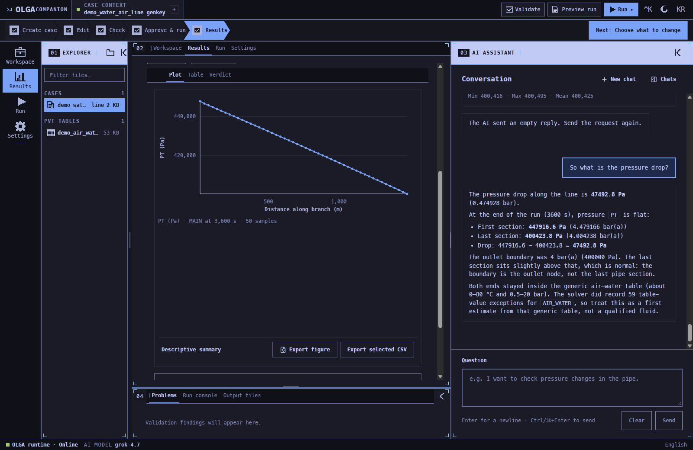
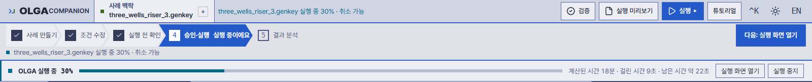
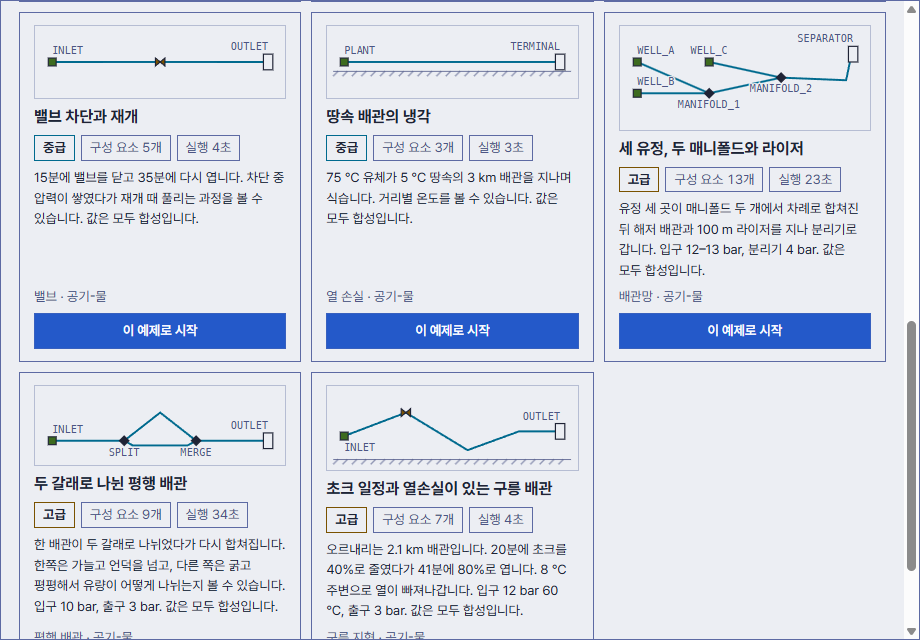
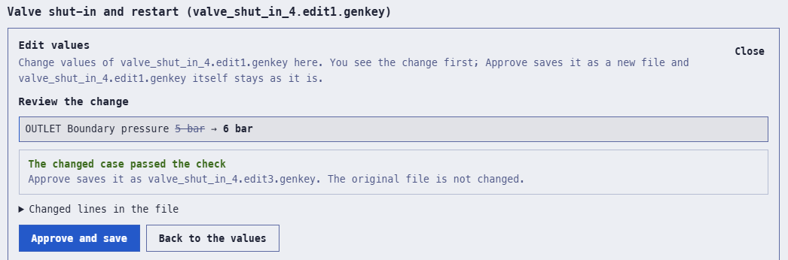

<div align="center">

<a id="olga-companion"></a>

<picture>
  <source media="(prefers-reduced-motion: reduce) and (prefers-color-scheme: dark)" srcset="./docs/assets/readme/cover-dark.png" />
  <source media="(prefers-reduced-motion: reduce)" srcset="./docs/assets/readme/cover-light.png" />
  <source media="(prefers-color-scheme: dark)" srcset="./docs/assets/readme/cover-dark.webp" />
  
</picture>

<h1>OLGA Companion</h1>

<p><b>Describe a multiphase pipeline in plain words. Approve each step. Run OLGA. Read the answer.</b></p>

<p><b>English</b> · <a href="./README.ko.md">한국어</a></p>

<p>
  <a href="https://github.com/wjgoarxiv/olga-companion/releases/latest"></a>
  
  
  <a href="./LICENSE"></a>
  
</p>

<p>
  <a href="#quick-start">Quick start</a> ·
  <a href="#try-the-tutorial">Tutorial</a> ·
  <a href="./docs/intro.html">Intro slides</a> ·
  <a href="#your-first-simulation-in-five-steps">Five steps</a> ·
  <a href="#features">Features</a> ·
  <a href="#safety-model">Safety model</a> ·
  <a href="#faq-and-troubleshooting">FAQ</a> ·
  <a href="#documentation">Docs</a> ·
  <a href="#contributing">Contributing</a>
</p>

</div>

OLGA Companion is a local Windows desktop app for engineers who use OLGA or are learning it. You chat with an AI assistant that builds, checks and runs real OLGA cases on your machine. **Anything consequential, such as writing a file, saving a case or starting a simulation, stops at an approval card and waits for your click. The assistant cannot approve for you.**

## Quick start

1. Download the Windows installer (`_x64-setup.exe`, or the `.msi`) from the [latest release](https://github.com/wjgoarxiv/olga-companion/releases/latest).
2. Run it. If WebView2 is missing, the installer fetches it.
3. Open **OLGA Companion**, connect an AI provider in **Settings**, and pick a folder for your cases.
4. Press **Tutorial** in the title bar. It walks you through a first case in seven steps.

> [!IMPORTANT]
> The installer is not code-signed yet, so Windows SmartScreen may warn you. Before running it, compare its SHA-256 with `SHA256SUMS.txt` attached to the release.

## Try the tutorial

<a href="https://wjgoarxiv.github.io/olga-companion/tutorial/">
  <picture>
    <source media="(prefers-reduced-motion: reduce) and (prefers-color-scheme: dark)" srcset="./docs/assets/readme/tutorial-preview-dark.png" />
    <source media="(prefers-reduced-motion: reduce)" srcset="./docs/assets/readme/tutorial-preview-light.png" />
    <source media="(prefers-color-scheme: dark)" srcset="./docs/assets/readme/tutorial-preview-dark.webp" />
    
  </picture>
</a>

**[Open the tutorial in your browser](https://wjgoarxiv.github.io/olga-companion/tutorial/)**. It is a practice copy of the app's screen that you can click through. It uses the same layout, colours, step bar, approval card and stepped motion, and its two paths follow the same seven-step tours as the **Tutorial** button inside the app. Nothing in it connects to OLGA or to an AI provider, and every value is synthetic.

- **Two paths.** “데모로 둘러보기” installs the synthetic air–water horizontal pipe and takes it from check to results. “내 배관표로 시작” goes through the pipe-table wizard (표 고르기 → 내용 확인 → 끝점 값 → 요청 넣기), sends the request, approves the save card, then checks, runs and reads the separator flow with the table's own names.
- **A third path in the app.** The in-app **Tutorial** button also offers “따라 하기: 값 하나 바꾸기”, a six-step lesson that changes the end time of the demo case in the edit table, approves the copy, runs it and reads its result. It has no check step and is not on the web page.
- **Offline copy.** The same page is [`docs/tutorial/index.html`](./docs/tutorial/index.html). Download the repository and open that file in a browser; it needs no server and no network.
- **Light, dark and motion off.** A theme switch and a motion control (끔 / 은은함 / 전체) sit in the page header. The page follows your system settings until you choose.
- The tutorial text is Korean, quoted from the app's Korean interface.

## Your first simulation in five steps

The step bar at the top of the app always shows where you are and what comes next.

| Step | What you do | What you see when it is done |
|---|---|---|
| **1. Create case** | Describe the pipe in chat, install the demo, or build a case from a pipe table. | The case is saved in your workspace and opens. |
| **2. Edit** | Press **Edit values** in the Workspace view and type new numbers, or ask in chat in your own units. Either way you review the change and approve the save. | A new reviewed copy. Your original `.genkey` is never changed in place. |
| **3. Check** | Press **Validate** in the title bar. The case is checked before any run. | The problems panel lists errors and warnings for this case. |
| **4. Approve & run** | Open the run screen, preview the exact command, then press **Approve and run** yourself. | Live progress, a time limit and a stop button. |
| **5. Results** | Open **Results**. | Trends and profiles from the run's `.tpl` and `.ppl` files, with plots and CSV export. |

A real session, shortened. The numbers are what the app and OLGA produced.

```text
You     I'm new to OLGA. Water 4 kg/s and air 0.05 kg/s flow through a horizontal
        steel pipe, 1.5 km long, 120 mm inside diameter. Outlet 4 bar(a), 30 °C.
        How much does the pressure drop?

Agent   Proposes a closed inlet with one mass-flow feed (4.05 kg/s, water fraction
        4/4.05 = 0.987654), steel roughness 4.5e-5 m, 50 sections, 3600 s, and a
        copy of the generic air-water table. Then it waits for your yes.

You     Yes, all as proposed.

        [Approve: write table]  [Approve: save case]  [Approve: run OLGA]

Agent   First section 447 916.6 Pa, last section 400 423.8 Pa, so the pressure
        drop is 47 492.8 Pa (0.475 bar). This used the generic table, so treat
        it as a first estimate.
```

## Features

<table>
<tr>
<td width="50%" valign="top">

**Chat-first case building**<br />
Give the pipe, the flows and the outlet in your own units. The assistant converts them, proposes what you left out (roughness, sections, end time) with its reasons, and asks before it fills anything in.

</td>
<td width="50%" valign="top">

**Approval cards**<br />
Every write, save and run lists its exact inputs: pressures, flows, fractions, coordinates. Nothing happens until you press **Approve**. Each approval works once and expires after ten minutes.

</td>
</tr>
<tr>
<td></td>
<td></td>
</tr>
<tr>
<td valign="top">

**Real OLGA runs**<br />
Runs use your local OLGA in a managed sandbox, with live progress, a time limit and cancellation. Single runs and parameter sweeps both wait for your approval.

</td>
<td valign="top">

**Results you can check**<br />
Trends from `.tpl` and profiles along the pipe from `.ppl`, plots, and CSV exports tied to the file they came from. The assistant answers from the values it read out of the run's files.

</td>
</tr>
<tr>
<td></td>
<td></td>
</tr>
<tr>
<td valign="top">

**Pipe tables and case inspection**<br />
Build a network from a `.csv` or `.xlsx` pipe table with a four-step wizard. It asks only for the end values the table is missing and puts a request in the chat box without sending it. Inspect the network, geometry and fluid tables of a `.genkey` without opening OLGA.

</td>
<td valign="top">

**Fluid tables and your own AI**<br />
Make a missing `.tab` from the `.mfl` next to the case with the Multiflash engine installed with OLGA, write one from property values you already have, or start from the bundled generic air–water table. Connect OpenAI (Codex), GitHub Copilot, Antigravity (Gemini) or xAI (Grok), or add an API key for an OpenAI-compatible endpoint. HD AIC has a ready-made entry that fills in the address and lists the models your key can use.

</td>
</tr>
<tr>
<td valign="top">

**Run progress on every screen**<br />
While OLGA runs, a strip under the step bar shows the percent, the simulated time, the time taken and an estimate of the time left, with buttons to open the run screen or stop. It stays put while you look at other screens, and when the run ends it offers **Open results**.

</td>
<td valign="top">

**Example gallery**<br />
Eleven ready-made air–water cases, from one horizontal pipe to three wells joining at two manifolds before a riser. Each card draws the network it builds, gives its difficulty by a stated rule and its component count, and shows how long it took to run on the reference PC.

</td>
</tr>
<tr>
<td></td>
<td></td>
</tr>
<tr>
<td colspan="2" valign="top">

**Edit values by hand**<br />
Press **Edit values** on an open case to change end time, boundary pressure and temperature, mass flow, valve opening or pipe roughness in bar, °C, kg/s, % and mm, without the assistant. The change gets the same checks as an assistant edit: it is compiled and validated, you see what changes, and nothing is saved until you press **Approve and save**. The result is a new file beside the original, and the original is never changed. For a case the app did not make, the table offers only the end time; ask the assistant for other changes.

</td>
</tr>
<tr>
<td colspan="2"></td>
</tr>
</table>

Cases, chats and run records are stored on your machine. What you type in the chat goes to the AI provider you connect. The interface is available in English and Korean, with light and dark themes, a motion setting and a text-size setting.

## Safety model

OLGA Companion treats simulation files and model output as untrusted input.

| Boundary | Behaviour |
|---|---|
| Running OLGA | The exact command is previewed and needs your approval. |
| Saving a case | Needs approval. Source `.genkey` files are never changed in place. |
| Writing files | Only inside the selected workspace or the app's own sandbox. |
| Approvals | Single use, valid for ten minutes, never shown to the chat model. The assistant cannot press them. |
| Network | The sidecar listens on loopback only, and `/api/*` needs a per-launch session token. The AI tools bridge (`/api/bridge/*`) uses its own secret per connected tool instead. |
| Result files | Hashed before and after reading; a file that changed during the read is rejected. |
| Updates | By default the app checks once for a new version shortly after it starts and tells you in the status bar; turn this off in **Settings → Updates**. Downloading and installing are separate clicks, and each release is verified against a public key built into the app. |

The full contract is in [Safety Gates](docs/SAFETY_GATES.md).

## AI tools bridge

**Settings → Connect AI tools** lets Claude Code, Codex or Gemini CLI use this app's tools. They can read cases and results directly. Anything that writes, runs or stops still waits for your approval card in the app.

- For Codex and Gemini CLI, **Connect** adds one entry (`olga-companion`) to the tool's settings file and keeps a backup of the old file. Restart the tool afterwards.
- For Claude Code, **Connect** gives you a command to paste in a terminal.
- The command holds a secret for that connection only, so treat it like a password. **Connect again** makes a new secret and the old command stops working.

## Local CLI provider

If Claude Code is installed on this PC (Windows) and you are signed in to it, the chat can use it as its AI. Pick **Local CLI (this PC)** under **Settings → AI provider**.

- **Your sign-in stays with Claude Code.** The app only starts the `claude` program and never sees your sign-in: it does not ask for, read or store a token or key. Usage counts against your own plan or key, and the panel shows which one.
- **Signing in.** Open PowerShell, run `claude`, sign in there and exit. Then select **Check** in the panel.
- **What Check costs.** Check sends one very short request through Claude Code, so it uses a small amount of your plan or key. Finding the program and showing its version cost nothing.
- **Same safety as the built-in assistant.** Claude Code gets only this app's tools, with its own file and shell tools switched off. It can read cases and results; anything that writes, runs or stops ends its turn and shows the usual approval card. User plugins you added to your own Claude Code are outside what this app can check; if one shows up during a turn, the turn stops with `isolation_failed`.
- **WSL is not supported.** Install Claude Code on Windows itself; an install that lives only inside WSL is not found.

Problems the panel can show while finding the program:

| Code | Meaning |
|---|---|
| `not_installed` | Claude Code was not found on this PC. Install it on Windows, then select **Find again**. |
| `override_missing` | A saved Claude Code location no longer has the program. Reinstall, then select **Find again**. |
| `not_executable` | The executable could not be started; security software may block it. |
| `probe_timeout` | Claude Code did not answer the version check. |
| `version_too_old` | Update with `claude update`. |
| `flags_missing` | This version lacks options the app needs; update with `claude update`. |
| `cmd_shim_unsafe` | The install path has characters that cannot be passed safely; use the native install (`claude.exe`). |

Problems a chat turn or Check can report:

| Code | Meaning |
|---|---|
| `not_logged_in` | Not signed in. Run `claude` in PowerShell and sign in. |
| `login_expired` | The sign-in expired. Sign in again the same way. |
| `rate_limited` | Your usage limit was reached; try after it resets. |
| `org_policy` | Your organization's policy refused the request. |
| `network` | Claude Code could not reach the internet; check the network or proxy. |
| `timeout` | No answer in time, so the turn was stopped. |
| `cancelled` | You cancelled the request. |
| `crashed` | Claude Code stopped unexpectedly; check the install with `claude --version`. |
| `output_too_large` | The reply was too large; ask a narrower question. |
| `bad_output` | The output could not be read; update Claude Code. |
| `isolation_failed` | Claude Code tried to use a tool other than this app's, so the turn was stopped. |
| `tools_unavailable` | The app's own tools could not start, so the turn was stopped. Restart the app; if it repeats, check whether security software blocks it. |
| `unknown` | Claude Code reported some other error. |

## How to tell a genuine download

OLGA Companion is open source, so anyone may copy and rebuild it. Only the copies published here are checked by the author.

1. Download only from the [releases page](https://github.com/wjgoarxiv/olga-companion/releases). A copy from a mail attachment, a shared drive or another website may have been changed.
2. Before you run the installer, compare its SHA-256 with the line for it in `SHA256SUMS.txt` on the same release. In PowerShell:
   ```powershell
   Get-FileHash .\OLGA-Companion_<version>_x64-setup.exe -Algorithm SHA256
   ```
   If the two values differ, delete the file.
3. Once installed, updates are verified by the app itself: an update that is not signed with the release key is refused.
   From 0.1.25 on, the app updates itself. A version older than 0.1.25 cannot verify current releases, because the update key changed: download the latest installer from the releases page and run it once. Your cases and settings stay. The details are in [Updater signing key](docs/UPDATER-KEY.md).
4. **About** (bottom of the left bar, or `Ctrl+K` → About) shows the version and author, and states that the app is independent of SLB. OLGA is a product of SLB; this app is not affiliated with, endorsed by or sponsored by SLB.

If you find a copy that claims to be OLGA Companion but did not come from this page, please open an issue.

## Requirements

| Dependency | Needed for | Notes |
|---|---|---|
| Windows x64 | Everything | OLGA is Windows software |
| OLGA | Real runs | Tested with OLGA 2022.1. Inspection and result reading work without it |
| An AI provider | Chat | OpenAI (Codex), GitHub Copilot, Antigravity (Gemini), xAI (Grok), or an API key |
| Multiflash | Optional | Case-specific fluid tables; the app makes the `.tab` from an `.mfl` with the Multiflash engine that comes with OLGA |

## FAQ and troubleshooting

<details>
<summary><b>Windows SmartScreen blocks the installer.</b></summary>

The installer is unsigned for now. Check its SHA-256 against `SHA256SUMS.txt` on the release page, then choose **More info → Run anyway**.

</details>

<details>
<summary><b>I don't have OLGA on this PC. Can I still use the app?</b></summary>

Yes. You can build and check cases, inspect `.genkey` files and read existing `.tpl`/`.ppl` results. Running a simulation needs a licensed local OLGA. If the app cannot find OLGA, the in-app tutorial stops at the run step.

</details>

<details>
<summary><b>The assistant stalled or sent an empty reply.</b></summary>

AI models sometimes do. The app shows a retry notice; asking again continues the work. Nothing was saved or run, because those steps wait for your approval.

</details>

<details>
<summary><b>Replies keep dropping on a company network.</b></summary>

**Settings → Network** can route provider traffic through a local proxy your administrator approved. See [Network](docs/NETWORK.md).

</details>

<details>
<summary><b>An approval card says it has expired.</b></summary>

Each card is valid for ten minutes and works once. Ask the assistant to propose the step again and approve the new card.

</details>

<details>
<summary><b>Where does the app write files?</b></summary>

Cases and tables go into the workspace folder you picked. Runs happen in a sandbox copy managed by the app, so the source case stays as it was.

</details>

<details>
<summary><b>Build from source and the Windows package</b></summary>

Needs Node.js 22.12+, Python 3.11+ and `uv`.

```bash
git clone https://github.com/wjgoarxiv/olga-companion.git
cd olga-companion
npm ci
uv sync --extra results --group dev
npm run verify         # frontend tests, typecheck, build, backend tests
npm run dev:app        # frontend :5273, sidecar :8865
```

**Windows package.** An installer also needs the Rust MSVC toolchain and PyInstaller. The installer ships the desktop shell, the frozen Python sidecar and the OLGA toolkit scripts; it does not contain OLGA. See the [Packaging Runbook](docs/PACKAGING.md).

</details>

<details>
<summary><b>Known limitations</b></summary>

- **Windows only.** OLGA itself is Windows software.
- **Real runs need a licensed OLGA installation.**
- **Descriptive, not prescriptive.** Summaries describe what the run shows; whether a design passes is the engineer's call.
- **The bundled air-water table is generic** (CPA, 0–80 °C, 0.5–20 bar) and meant for learning and quick checks. OLGA reports table-value warnings with it; use a case-specific table for real work.
- **Making a table from an `.mfl` needs the Multiflash engine that comes with OLGA** (tested with OLGA 2022.1.0, Multiflash 7.3). It writes the OLGA table only; hydrate and wax files are still made in Multiflash.
- **The independent fluid-table generator is available in local builds only.** Release builds leave it out, and its tables are not Multiflash-identical.
- **AI models can stall or return an empty reply.** The app shows a retry notice; asking again continues the work.
- **Installers are unsigned** until a code-signing identity is set up.

</details>

## How it works

```
  [ React UI ]  Tauri 2 WebView, English / 한국어
       |  authenticated local HTTP + SSE (127.0.0.1)
       v
  [ Python sidecar ]  FastAPI, frozen with PyInstaller
       +--> chat agent        tools, approval cards, your AI provider
       +--> case pipeline     .genkey spec / check / compile / save
       +--> run supervisor    sandbox, live progress, cancel, time limit
       +--> result reader     .tpl / .ppl, hash-checked
       v
  [ OLGA ]  your licensed local installation, never bundled, never modified
```

## Documentation

| Document | What it covers |
|---|---|
| [Interactive tutorial](https://wjgoarxiv.github.io/olga-companion/tutorial/) | The practice page: demo and pipe-table paths, seven steps each |
| [Architecture](docs/ARCHITECTURE.md) | Components and storage boundaries |
| [Safety Gates](docs/SAFETY_GATES.md) | File, run and result rules in full |
| [Pipe tables](docs/PIPE_TABLE.md) | Columns, endpoints, junctions and limits of the pipe-table import |
| [Make a .tab from your values](docs/TAB_IMPORT.md) | Writing an OLGA PVT table from values you already have |
| [Network](docs/NETWORK.md) | Proxy settings for company networks |
| [Packaging Runbook](docs/PACKAGING.md) | Building the Windows installer |
| [Updater signing key](docs/UPDATER-KEY.md) | Which key signs updates, and when to install by hand once |

## Contributing

Issues and pull requests are welcome. Branch from `master`, keep changes small, add a regression test for any behaviour change, and say in the pull request what you verified.

- [Contributing guide](./CONTRIBUTING.md): setup, tests, commit and pull request rules
- [Security policy](./SECURITY.md): report vulnerabilities privately
- [Code of conduct](./CODE_OF_CONDUCT.md): Contributor Covenant 2.1
- [License](./LICENSE): Apache 2.0

## License

[Apache License 2.0](./LICENSE) (see [NOTICE](./NOTICE)). The engine folder [`src/olga_companion/pvt_engine/`](src/olga_companion/pvt_engine/LICENSE) is MIT-licensed. The tutorial page bundles Pretendard (SIL OFL 1.1) and Meslo LGS NF (Apache 2.0); their licence texts are in [`docs/tutorial/assets/fonts/`](docs/tutorial/assets/fonts/).

OLGA is a product of SLB. This is an independent companion application, not affiliated with, endorsed by or sponsored by SLB.

<div align="center">

Made by **[Woojin Go](https://github.com/wjgoarxiv)** · <a href="#olga-companion">Back to top ↑</a>

</div>
