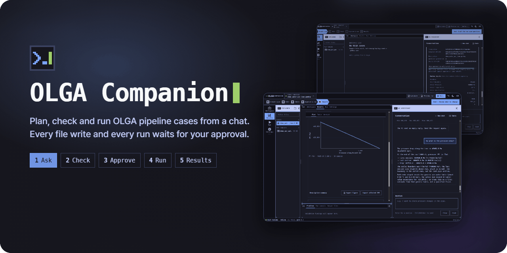
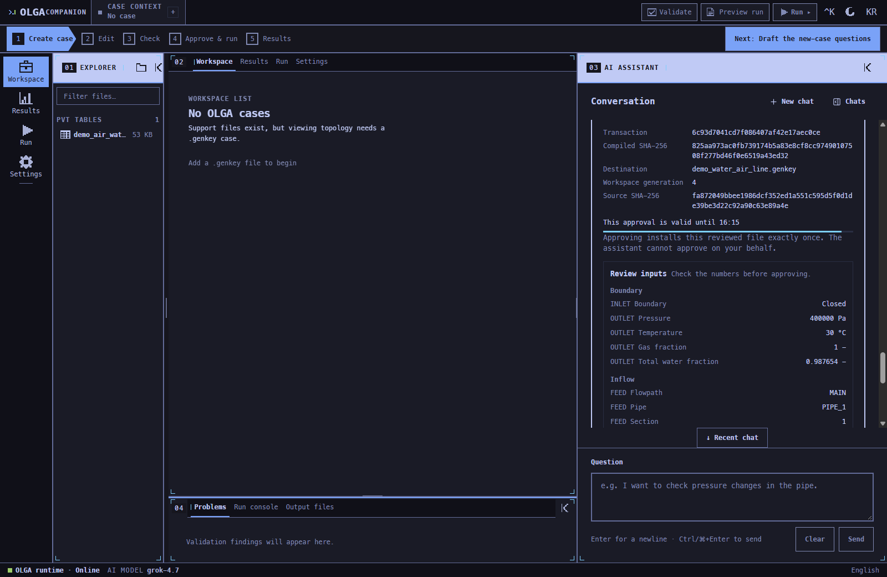
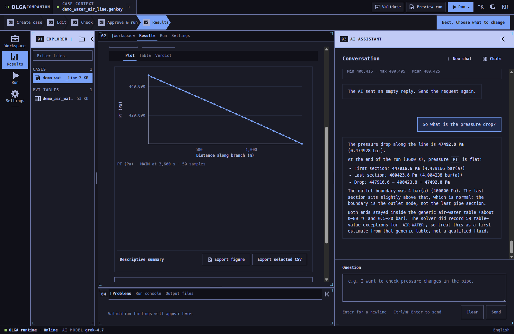
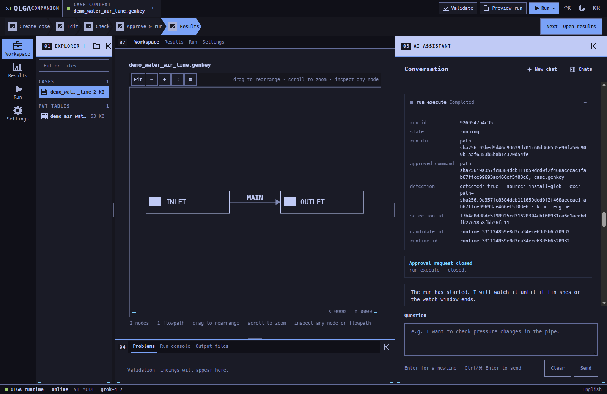
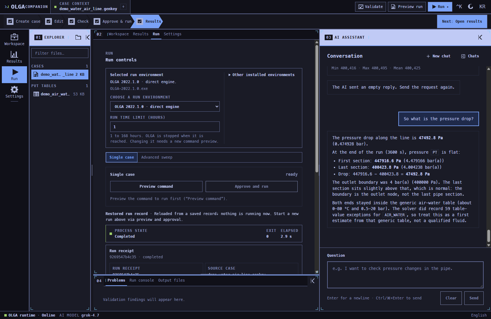

<div align="center">

<picture>
  <source media="(prefers-reduced-motion: reduce)" srcset="./assets/cover-poster.png" />
  <source media="(prefers-color-scheme: dark)" srcset="./assets/cover-dark.gif" />
  
</picture>

<a id="olga-companion"></a>
<h1>OLGA Companion</h1>

<p><b>Describe a multiphase pipeline in plain words. Approve each step. Run OLGA. Read the answer.</b></p>

<p>
  <a href="https://github.com/wjgoarxiv/olga-companion/releases/latest"></a>
  
  
  <a href="./LICENSE"></a>
  
</p>

<p>
  <a href="#-quick-start">Quick start</a> ·
  <a href="#-what-it-does">What it does</a> ·
  <a href="#-a-first-case">First case</a> ·
  <a href="#-safety-model">Safety model</a> ·
  <a href="#-how-it-works">How it works</a>
</p>

</div>

---

> [!NOTE]
> OLGA Companion is a local Windows desktop app for engineers who use, or are learning, OLGA. You chat with an AI assistant that builds, checks and runs real OLGA cases. **Anything consequential, such as writing a file, saving a case or starting a simulation, stops at an approval card and waits for your click.** The assistant cannot approve for you.

## ✨ What it does

<table>
<tr>
<td width="50%" valign="top">

### 💬 Chat-first case building
Give the pipe, the flows and the outlet in your own units. The assistant converts them, proposes what you left out (roughness, sections, end time) with its reasons, and asks before it fills anything in.

</td>
<td width="50%" valign="top">

### ✅ Approval cards
Every write, save and run lists its exact inputs: pressures, flows, fractions, coordinates. Nothing happens until you press **Approve**. Each approval works once and expires after ten minutes.

</td>
</tr>
<tr>
<td valign="top">

### ▶️ Real OLGA runs
Runs use your local OLGA in a managed sandbox, with live progress, a time limit and cancellation. Your `.genkey` files are never changed in place.

</td>
<td valign="top">

### 📈 Results you can check
Trends from `.tpl` and profiles along the pipe from `.ppl`, plots, and CSV exports tied to the file they came from. The assistant answers from the values it read out of the run's files.

</td>
</tr>
<tr>
<td valign="top">

### 🗺️ Case inspection and pipe tables
See the network, geometry, fluid tables and check findings of a `.genkey` without opening OLGA. Build a large network from a `.csv` or `.xlsx` pipe table, reviewed as a draft before anything is saved.

</td>
<td valign="top">

### 🔌 Bring your own AI
Connect OpenAI (Codex), GitHub Copilot, Antigravity (Gemini) or xAI (Grok), or add an API key for an OpenAI-compatible endpoint. Cases, chats and run records are stored on your machine; what you send in the chat goes to the provider you connect.

</td>
</tr>
</table>

<table>
<tr>
<td width="50%"></td>
<td width="50%"></td>
</tr>
<tr>
<td align="center"><sub>Approval card with every input</sub></td>
<td align="center"><sub>Pressure profile and the answer</sub></td>
</tr>
<tr>
<td></td>
<td></td>
</tr>
<tr>
<td align="center"><sub>Case network</sub></td>
<td align="center"><sub>Run controls and receipt</sub></td>
</tr>
</table>

## 🚀 Quick start

1. Download `OLGA-Companion_0.1.1_x64-setup.exe` (or the `.msi`) from the [latest release](https://github.com/wjgoarxiv/olga-companion/releases/latest).
2. Run it. If WebView2 is missing, the installer fetches it.
3. Open **OLGA Companion**, connect an AI provider in **Settings**, and pick a folder for your cases.

> [!IMPORTANT]
> The installer is not code-signed yet, so Windows SmartScreen may warn you. Before running it, compare its SHA-256 with `SHA256SUMS.txt` attached to the release.

## 🧪 A first case

A real session, shortened. The numbers are what the app and OLGA produced.

```text
You     I'm new to OLGA. Water 4 kg/s and air 0.05 kg/s flow through a horizontal
        steel pipe, 1.5 km long, 120 mm inside diameter. Outlet 4 bar(a), 30 °C.
        How much does the pressure drop?

Agent   Proposes a closed inlet with one mass-flow feed (4.05 kg/s, water fraction
        4/4.05 = 0.987654), steel roughness 4.5e-5 m, 50 sections, 3600 s, and a
        copy of the generic air-water table. Then it waits for your yes.

You     Yes, all as proposed.

        [Approve: write table]  [Approve: save case]  [Approve: run OLGA]

Agent   First section 447 916.6 Pa, last section 400 423.8 Pa, so the pressure
        drop is 47 492.8 Pa (0.475 bar). This used the generic table, so treat
        it as a first estimate.
```

## 🛡 Safety model

OLGA Companion treats simulation files and model output as untrusted input.

| Boundary | Behaviour |
|---|---|
| Running OLGA | The exact command is previewed and needs your approval. |
| Saving a case | Needs approval. Source `.genkey` files are never changed in place. |
| Writing files | Only inside the selected workspace or the app's own sandbox. |
| Approvals | Single use, valid for ten minutes, never shown to the chat model. |
| Network | The sidecar listens on loopback only, and `/api/*` needs a per-launch session token. |
| Result files | Hashed before and after reading; a file that changed during the read is rejected. |
| Updates | By default the app checks once for a new version shortly after it starts and tells you in the status bar; turn this off in **Settings → Updates**. Downloading and installing are separate clicks, and each release is verified against a public key built into the app. |

The full contract is in [Safety Gates](docs/SAFETY_GATES.md).

## 🧩 How it works

```
  [ React UI ]  Tauri 2 WebView, English / 한국어
       |  authenticated local HTTP + SSE (127.0.0.1)
       v
  [ Python sidecar ]  FastAPI, frozen with PyInstaller
       +--> chat agent        tools, approval cards, your AI provider
       +--> case pipeline     .genkey spec / check / compile / save
       +--> run supervisor    sandbox, live progress, cancel, time limit
       +--> result reader     .tpl / .ppl, hash-checked
       v
  [ OLGA ]  your licensed local installation, never bundled, never modified
```

See [Architecture](docs/ARCHITECTURE.md) for component and storage boundaries.

On an enterprise PC where provider responses keep dropping mid-stream, the **Settings → Network** panel can route them through a local proxy that the administrator approved. See [Network](docs/NETWORK.md).

## 📋 Requirements

| Dependency | Needed for | Notes |
|---|---|---|
| Windows x64 | Everything | OLGA is Windows software |
| OLGA | Real runs | Tested with OLGA 2022.1. Inspection and result reading work without it |
| An AI provider | Chat | OpenAI (Codex), GitHub Copilot, Antigravity (Gemini), xAI (Grok), or an API key |
| Multiflash | Optional | Case-specific fluid tables; the app prepares the input and you run it in Multiflash |

<details>
<summary><b>🔧 Build from source and the Windows package</b></summary>

Needs Node.js 22.12+, Python 3.11+ and `uv`.

```bash
git clone https://github.com/wjgoarxiv/olga-companion.git
cd olga-companion
npm ci
uv sync --extra results --group dev
npm run verify         # frontend tests, typecheck, build, backend tests
npm run dev:app        # frontend :5273, sidecar :8865
```

**Windows package.** An installer also needs the Rust MSVC toolchain and PyInstaller. The installer ships the desktop shell, the frozen Python sidecar and the OLGA toolkit scripts; it does not contain OLGA. See the [Packaging Runbook](docs/PACKAGING.md).

</details>

<details>
<summary><b>⚠️ Known limitations</b></summary>

- **Windows only.** OLGA itself is Windows software.
- **Real runs need a licensed OLGA installation.**
- **Descriptive, not prescriptive.** Summaries describe what the run shows; whether a design passes is the engineer's call.
- **The bundled air-water table is generic** (CPA, 0–80 °C, 0.5–20 bar) and meant for learning and quick checks. OLGA reports table-value warnings with it; use a case-specific table for real work.
- **Multiflash table generation is a manual step** in Multiflash; the app prepares the input file.
- **The independent fluid-table generator is available in local builds only.** Release builds leave it out, and its tables are not Multiflash-identical.
- **AI models can stall or return an empty reply.** The app shows a retry notice; asking again continues the work.
- **Installers are unsigned** until a code-signing identity is set up.

</details>

## 🤝 Contributing

Issues and pull requests are welcome. Branch from `master`, keep changes small, add a regression test for any behaviour change, and say in the pull request what you verified.

## License

[Apache License 2.0](./LICENSE) (see [NOTICE](./NOTICE)). The engine folder [`src/olga_companion/pvt_engine/`](src/olga_companion/pvt_engine/LICENSE) is MIT-licensed.

OLGA is a product of SLB. This is an independent companion application, not affiliated with, endorsed by or sponsored by SLB.

<div align="center">

Made by **[Woojin Go](https://github.com/wjgoarxiv)** · <a href="#olga-companion">Back to top ↑</a>

</div>
